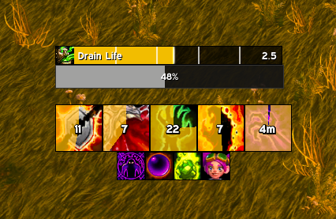

# ThreatBar

ElvUI-style **player-only** threat data bar for [WoW Forever](https://worldofwarcraft.blizzard.com/en-us/forever). One bar: **your** threat on the current target — not the raid list.

EllesmereUI already ships a full group threat meter. Keep that. This is the extra strip you park on the cast bar so you never hunt yourself in a top-10 list.

| | |
|---|---|
| Client | WoW Forever (`## Interface: 16001`) |
| Optional | EllesmereUI (window skin + cast-bar fill texture) |
| License | MIT |

Forever does not give addons `COMBAT_LOG_EVENT`. The bar reads `UnitDetailedThreatSituation("player", "target")` and colours with `GetThreatStatusColor`.



## Install

1. Download the repo (Code → Download ZIP) or clone it.
2. Put the **`ThreatBar` folder** (the one that contains `ThreatBar.toc`) into:

   `_forever_/Interface/AddOns/ThreatBar/`

3. **Quit the client fully.** A new `.toc` does not load on `/reload`.
4. Enable **ThreatBar** on the character addon list.

## Place it on the cast bar

1. `/threatbar test` — fills at 80% for 10 seconds so you can see it out of combat.
2. Drag the bar onto your cast bar. Drag the bottom-right grip to match width/height.
3. `/threatbar lock`

Unlocked, the bar stays on screen even with no threat so you can move it. Locked (default combat mode), it only shows in combat when you have threat.

## Commands

| Command | What |
|---|---|
| `/threatbar` or `/tbar` | show/hide (master toggle) |
| `/threatbar lock` | lock/unlock move and resize |
| `/threatbar test` | 80% preview for 10 seconds |
| `/threatbar text` | percent text on/off |
| `/threatbar combat` | hide out of combat (on by default) |
| `/threatbar reset` | default size and position |

`/threatbar` hide is not the same as combat-only. Hide means it never appears, even in combat, until you toggle it back.

## EllesmereUI

If EllesmereUI is loaded, chrome is skinned through `EllesmereUI.RegisterSkin` (Blizzard Skins+ → Window Skins → Third-Party Addons → ThreatBar). The **fill** follows your player cast bar texture (not the house XP-bar green). Threat colour still overrides the fill tint.

## Honesty

This is **your** threat on **your current target** only. It does not list the raid. Use EllesmereUI’s threat meter (or Details Tiny Threat) when you want the whole table.

## Files

```
ThreatBar/
  ThreatBar.toc
  ThreatBar.lua
  README.md
  LICENSE
  CHANGELOG.md
```
